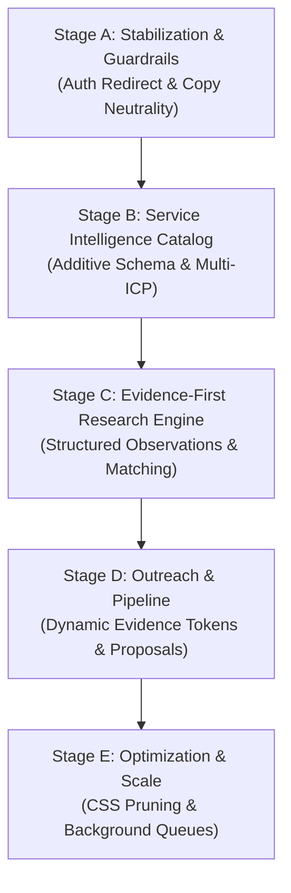

# Kestrel — Vision Gap Analysis (A–Q) & Validated Roadmap

> **Status:** Code-Grounded Vision Gap Analysis & Roadmap Resolution  
> **Audited Date:** 22 November 2026 (Validation Pass 2)  
> **Target Vision:** Service-Agnostic Client Intelligence & Growth Platform  
> **Target Workflow:** Discover businesses → Understand them using evidence → Identify possible needs → Match configured services → Outreach → Close clients → Deliver projects → Grow.

---

## 1. Strict Status Labeling System

Every capability and feature in this audit is evaluated against code inspection and automated test results using six strict labels:

| Label | Definition | Verification Criteria |
|---|---|---|
| **`VERIFIED`** | Fully functional and confirmed by code AND automated test execution. | Test exists in `scripts/verify-all.mjs` and passes at runtime. |
| **`CODE-OBSERVED`** | Fully implemented in code, but tested only via static code inspection or mocked client state. | Complete TypeScript/SQL implementation exists without live test proof. |
| **`TESTED`** | Automated UI test exists and passes, but runs against mocked/demo data rather than live external APIs. | Passes in Chromium headless against `DEMO_ACCOUNT` / `demoLeads()`. |
| **`UNVERIFIED`** | Code or integration exists, but live external credentials/services were not exercised. | Real SMTP, IMAP, Lemon Squeezy, or Live AI APIs. |
| **`PARTIAL`** | Capability is partially implemented, but significant workflow steps are missing. | Incomplete end-to-end user journey. |
| **`PLANNED`** | Planned capability that does not yet exist in the codebase. | No code or schema implemented. |

---

## 2. Capability Matrix: Current Implementation vs. Target Vision (A through Q)

| ID | Capability Name | Validated Status | Primary Code Files | Database & Schemas | Current State vs. Target Vision | Priority |
|---|---|---|---|---|---|---|
| **A** | **Business Discovery** | **PARTIAL** | `src/app/app/leads-view.tsx`, `downloads-private/Kestrel-extension-2.9.4.zip` | `002_leads.sql`, `004_extension_sync.sql` | **Current**: Manual CSV import or manual browser extension scraping on Google Maps. No in-app search.<br>**Target**: Automated business discovery search (Google Places API / Web search) directly inside Kestrel. | **High** |
| **B** | **Business Database & Lead Management** | **TESTED** | `src/lib/leads.ts`, `src/app/app/leads-view.tsx`, `lead-panel.tsx` | `002_leads.sql`, `021_lead_enrichment.sql`, `035_lead_merge.sql` | **Current**: Comprehensive flat lead records with deduplication, enrichment, tags, search, and status.<br>**Target**: Split flat lead into *Business Entity* (company, domain, tech) vs *Contact Person* (name, role, email). | **Medium** |
| **C** | **Service Intelligence Catalog** | **PARTIAL** | `src/app/app/about-view.tsx`, `src/lib/ai.ts` | `007_ai.sql` (`offer_profiles`), `003_team_about.sql` | **Current**: `offer_profiles` holds single-offer text snippets (`offer_name`, `summary`, `proof`).<br>**Target**: Multi-service catalog with deliverables, target problems, buying signals, and disqualifiers. | **High** |
| **D** | **Ideal Client Profile (ICP) & Scoring** | **PARTIAL** | `src/lib/scoring.ts`, `src/app/app/rules-view.tsx` | `012_rules_scoring.sql` (`team_rules`), `034_scoring_rework.sql` | **Current**: Rule-based scoring on category, location, and keywords, plus single-offer AI fit score.<br>**Target**: Multi-service ICP scoring evaluating evidence against each service independently. | **High** |
| **E** | **AI Research & Evidence Extraction** | **PARTIAL** | `src/lib/site-read.ts`, `src/lib/ai-server.ts`, `src/app/app/lead-panel.tsx` | `002_leads.sql` (`scraped_text`, `ai_research`), `036_audit_log.sql` | **Current**: Scrapes website HTML safely (SSRF protected); generates freeform Markdown summary.<br>**Target**: Structured evidence extraction with cited quotes, timestamps, source URLs, and confidence tags. | **High** |
| **F** | **Need & Signal Detection** | **PARTIAL** | `src/lib/lead-steps.ts`, `src/lib/ai.ts` | `007_ai.sql` (`ai_research` JSONB), `012_rules_scoring.sql` | **Current**: AI implicitly notes weaknesses in the freeform fit assessment.<br>**Target**: Explicit signal detector (e.g. broken checkout, outdated copyright, missing meta tags, hiring posts). | **High** |
| **G** | **Service Matching Engine** | **PLANNED** | None (Single active offer scoring only) | None | **Current**: Scores lead against only one selected offer.<br>**Target**: Automated matcher that compares extracted business evidence against all active catalog services. | **High** |
| **H** | **Opportunity Reports & Review Workflow** | **PLANNED** | None | None | **Current**: App jumps directly from scoring to email drafting without an intermediate review gate.<br>**Target**: Interactive Opportunity Report separating *Observations*, *Hypotheses*, *Unknowns*, and *Next Actions*. | **High** |
| **I** | **Outreach & Campaign Sequences** | **TESTED** | `src/lib/campaign.ts`, `src/app/app/campaigns-view.tsx`, `campaign-detail-view.tsx` | `016_campaigns.sql`, `018_sequences.sql`, `028_campaign_variants.sql` | **Current**: Multi-step sequences with A/B variant testing, delays, and generic tokens (`{{FIRST_NAME}}`).<br>**Target**: Dynamic evidence tokens (`{{OBSERVATION_1}}`, `{{EVIDENCE_QUOTE}}`) injected from Opportunity Report. | **Medium** |
| **J** | **Inbox & Reply Management** | **TESTED** | `src/lib/inbox.ts`, `src/app/app/inbox-view.tsx` | `017_inbox.sql` (`inbox_messages`, `inbox_threads`), `022_lead_timeline.sql` | **Current**: Threaded view, snooze, sentiment classification (Positive/Negative/Question), and pre-send reply gate.<br>**Target**: Automatic reply routing to pipeline deal stages and one-click proposal generation. | **Low** |
| **K** | **CRM & Sales Pipeline** | **TESTED** | `src/lib/pipeline.ts`, `src/app/app/pipeline-view.tsx` | `002_leads.sql` (`pipeline_stage`), `022_lead_timeline.sql` | **Current**: 5-column Kanban board (Prospect, Contacted, Meeting, Proposal, Won/Lost) with drag-and-drop.<br>**Target**: Card link to deal contracts, revenue tracking, and proposal milestones. | **Medium** |
| **L** | **Proposals & Deal Closing** | **PARTIAL** | `src/lib/pipeline.ts` (records deal value on Won) | `002_leads.sql` (`deal_value`, `won_at`) | **Current**: Prompt modal captures final monetary deal value when moved to "Won".<br>**Target**: Lightweight proposal card generator confirming deliverables, price, and payment link. | **Medium** |
| **M** | **Client Onboarding** | **PLANNED** | None | None | **Current**: No onboarding forms or welcome handoff workflows.<br>**Target**: Intake questionnaire and asset collection checklist generated upon deal close. | **Low** |
| **N** | **Projects & Deliverable Tracking** | **PLANNED** | None | None | **Current**: Post-deal execution handled outside Kestrel.<br>**Target**: Milestone tracker, deliverable checklists, and client revision request logger. | **Low** |
| **O** | **Automation & Workflow Engine** | **PARTIAL** | `src/lib/autopilot.ts`, `src/app/api/autopilot/tick/route.ts` | `015_autopilot.sql` (`autopilot_runs`, `autopilot_logs`) | **Current**: Cron-triggered Autopilot executes a fixed loop (find → score → draft).<br>**Target**: User-configurable triggers and conditional branching (e.g., if signal=broken_seo then trigger audit). | **Low** |
| **P** | **Analytics & Reporting** | **TESTED** | `src/app/app/analytics-view.tsx`, `placement-view.tsx` | `029_campaign_analytics.sql`, `050_usage_monitor.sql` | **Current**: Funnel metrics (sent, opened, clicked, replied, bounced) and usage charts.<br>**Target**: Revenue attribution analytics tying specific service recommendations to closed pipeline revenue. | **Medium** |
| **Q** | **Integrations & Security Management** | **VERIFIED** | `src/app/app/connections-keys.tsx`, `mcp-view.tsx`, `src/lib/vault.ts` | `037_integrations.sql`, `040_supabase_vault.sql`, `049_security_definer_audit.sql` | **Current**: Supabase Vault encrypted keys, webhook event queue, MCP server tool provider.<br>**Target**: Maintain zero-credential leakage and add audit logging for third-party connector syncs. | **Low** |

---

## 3. Audit of Hardcoded Agency Terminology

### 3.1 Code Inspection Scope & Evidence
A search across all `src/` directories identified **39 total occurrences** containing terms like "video", "editing", "motion", or "creative agency":

- `src/app/app/about-view.tsx`: 8 occurrences (all in UI `<input placeholder="e.g. Video Editing, Motion Graphics">` and demo sample text).
- `src/lib/demo-data.ts`: 14 occurrences (seed preview data for `DEMO_ACCOUNT`, `DEMO_OFFER`, and `demoLeads()`).
- `src/lib/ai.ts`: 9 occurrences (fallback instructions in default system prompts if user leaves `team_about` blank).
- `src/lib/assistant.ts`: 8 occurrences (sample suggested questions in the assistant UI).

### 3.2 Key Finding: Zero Backend Blocking Business Logic
> [!IMPORTANT]
> **There are ZERO hardcoded business rules in backend processing engines.**
> 
> The core engines (`src/lib/lead-steps.ts`, `src/lib/scoring.ts`, `src/lib/campaign.ts`, `src/lib/inbox.ts`, and `src/lib/site-read.ts`) operate on 100% dynamic database parameters.
> 
> Video editing references exist purely as:
> 1. UI placeholder attributes.
> 2. Demo preview data shown to unauthenticated visitors.
> 3. Fallback prompts when user profiles are empty.
> 
> **Conclusion**: Transforming Kestrel into a service-agnostic platform requires **zero architectural rewrites**. It only requires generalizing UI placeholder strings and introducing structured service definitions in the database.

---

## 4. Evaluation of Technical Debt & Architectural Risks

### 4.1 CSS Cleanup Risk Reevaluation (Why CSS Pruning is Postponed)
- `src/app/globals.css` is currently **29,882 lines (~1.1 MB)**.
- While ~590 selectors belong to retired chat bot components (`.as-*`, `.ask-fab`, `.bot-room`), **pruning CSS at this stage presents an unacceptably high risk of visual regression**.
- In `globals.css`, selectors are heavily grouped:
  ```css
  .as-card, .camp-card, .pipe-card {
    border: 1px solid var(--border);
    border-radius: 12px;
  }
  ```
- Naively deleting `.as-card` or running automated regex cleanup risks corrupting shared rules, breaking production layouts across untested screens.
- **Decision**: Postpone CSS pruning to **Stage E (Housekeeping)**. It must be executed with automated pixel-by-pixel visual regression testing (Playwright screenshots before and after) to guarantee zero layout breakage.

### 4.2 Database Migration Risk Reevaluation (Additive Schema Strategy)
- The table `offer_profiles` has **18 active query call sites** across 12 files (`about-view.tsx`, `ai.ts`, `lead-steps.ts`, etc.).
- Renaming or dropping existing columns (`offer_name`, `summary`, `proof`) would immediately crash existing queries.
- **Safe Migration Strategy**:
  - Keep `offer_profiles` completely intact.
  - Apply **additive nullable columns** in a new migration:
    ```sql
    ALTER TABLE offer_profiles 
      ADD COLUMN IF NOT EXISTS deliverables JSONB DEFAULT '[]'::jsonb,
      ADD COLUMN IF NOT EXISTS target_problems TEXT[] DEFAULT '{}',
      ADD COLUMN IF NOT EXISTS target_signals TEXT[] DEFAULT '{}',
      ADD COLUMN IF NOT EXISTS disqualifiers TEXT[] DEFAULT '{}',
      ADD COLUMN IF NOT EXISTS pricing_model TEXT,
      ADD COLUMN IF NOT EXISTS is_default BOOLEAN DEFAULT false;
    ```
- **Result**: Zero breaking changes, 100% backward compatibility, and full enablement of the multi-service catalog.

---

## 5. Resolution of Roadmap Contradictions

The previous audit contained conflicting recommendations regarding the immediate next step:
- One document ranked *Service Catalog Data Modeling* as #1.
- Another recommended *Removing Hardcoded Agency Terminology* first.
- A third included *CSS Pruning* in the immediate sprint.

### The Unified 5-Stage Roadmap



#### Stage A: Required Stabilization & Security Guardrails
- **Focus**: Zero-risk stabilization.
- Fix the unauthenticated `/app` demo fallback vulnerability (`page.tsx:53-57`) by adding an authentication check and redirect to `/login`.
- Generalize UI placeholder text and demo seeds to be service-neutral.

#### Stage B: Service-Agnostic Intelligence Catalog
- **Focus**: Define what services the user offers before matching them.
- Apply additive non-destructive schema extension to `offer_profiles`.
- Build the Service Intelligence Catalog UI (deliverables, problems, signals, disqualifiers).
- Implement multi-ICP rule evaluation.

#### Stage C: Core Product Development (Evidence & Matching)
- **Focus**: Evidence-first research without AI hallucination.
- Upgrade `site-read.ts` to output structured evidence with source URLs and timestamps.
- Build the Multi-Service Matching Engine (evidence vs. catalog).
- Build the interactive Opportunity Report Card review UI.

#### Stage D: Outreach & Pipeline Integration
- **Focus**: Convert verified opportunities into deals.
- Inject cited evidence tokens into sequence email templates.
- Link CRM pipeline deals to scope confirmation and lightweight proposals.

#### Stage E: Housekeeping, Optimization & Scaling
- **Focus**: Maintainability and performance.
- CSS monolith pruning with visual regression screenshot baselines.
- Migrate long-running serverless cron loops to a durable queue.
- In-app automated business discovery search.

---

## 6. Top 10 Ranked Tasks (With Complexity, Risk & Acceptance Criteria)

| Rank | Task Name | Stage | Target Capability | Complexity | Risk | Dependencies | Acceptance Criteria |
|---|---|---|---|---|---|---|---|
| **1** | **Auth Redirect Guardrail on `/app`** | **Stage A** | Security | **S** (1 day) | **Low** | None | Unauthenticated visitors to `/app` are redirected to `/login` with `returnTo` param. Demo mode requires explicit `?demo=true` or sandbox toggle. |
| **2** | **Generalize UI Placeholders & Demo Data** | **Stage A** | Agnostic Copy | **S** (1 day) | **Low** | None | Replace video-specific placeholders in `about-view.tsx` and `ai.ts` with generic business service examples. Zero broken inputs. |
| **3** | **Additive Schema Extension for Service Catalog** | **Stage B** | Capability C | **M** (2 days) | **Low** | Task 2 | Migration adds `deliverables`, `problems`, `signals`, `disqualifiers` to `offer_profiles`. All 18 existing query call sites continue to pass without error. |
| **4** | **Service Intelligence Catalog Management UI** | **Stage B** | Capability C | **M** (3 days) | **Low** | Task 3 | Users can create and manage multiple service offerings with explicit deliverables, pricing models, and target problems in `about-view.tsx`. |
| **5** | **Structured Evidence Schema in Research** | **Stage C** | Capability E | **M** (3 days) | **Medium** | Task 4 | `site-read.ts` outputs structured JSON containing `observations` (with URL quotes), `hypotheses`, and `unknowns`. Strict SSRF protection maintained. |
| **6** | **Multi-Service Opportunity Matching Engine** | **Stage C** | Capability G | **L** (4 days) | **Medium** | Task 5 | Backend engine matches extracted website evidence against all active catalog services; assigns fit scores (0-100%) and identifies matched services. |
| **7** | **Interactive Opportunity Report Card UI** | **Stage C** | Capability H | **L** (4 days) | **Low** | Task 6 | Clean review card between Lead Profile and Outreach showing cited evidence, matched services, and proposed pitch angles. Human approval required. |
| **8** | **Dynamic Evidence Tokens in Email Sequences** | **Stage D** | Capability I | **M** (2 days) | **Low** | Task 7 | Sequence parser supports `{{OBSERVATION_1}}` and `{{EVIDENCE_QUOTE}}` tokens populated directly from the approved Opportunity Report. |
| **9** | **Lightweight Proposal & Scope Confirmation** | **Stage D** | Capability L | **M** (3 days) | **Low** | Task 4, 8 | Moving a deal to "Proposal" or "Won" in Pipeline generates a shareable scope summary card with agreed deliverables and payment link. |
| **10** | **CSS Monolith Pruning via Visual Canary** | **Stage E** | Tech Debt | **L** (4 days) | **High** | Stable UI | Dead bot selectors pruned from `globals.css`. 100% pixel-diff match on all 23 views via Playwright screenshot comparison. |

---

## 7. Recommended Immediate Next Task

### Task 1.1: Secure `/app` Route with Authentication Guardrail
- **Target File**: `src/app/app/page.tsx`
- **Objective**: Prevent unauthenticated public visitors from automatically accessing full owner privileges in `/app`.
- **Implementation**: Inspect auth session. If user is null and no explicit `?demo=true` query flag is provided, redirect to `/login`.
- **Risk**: Low.
- **Estimated Effort**: 1 hour.
- **Status**: Ready for approval before implementation.