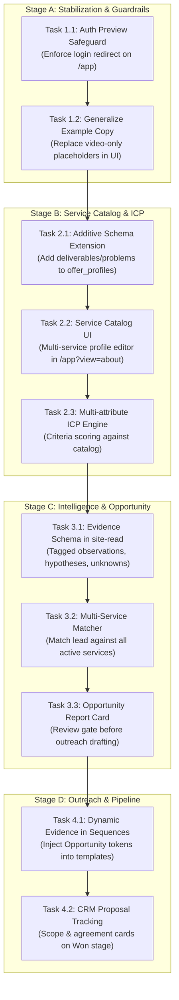

# Kestrel — System Architecture & Product Blueprint

> **Status:** Validated Phase 0 Baseline & Architecture Blueprint  
> **Audited Date:** 22 November 2026 (Validation Pass 2)  
> **Auditor Role:** Senior Software Architect, Product Engineer, Security Reviewer & Technical Lead  
> **Repository:** `quarry-cloud@0.1.0` (Next.js 16.4.6, React 19.3.0, Supabase PostgreSQL, Tailwind CSS v4)

---

## 1. Product Vision & Evolution

Kestrel is evolving from an agency-specific cold outreach automation tool into a **service-agnostic Client Intelligence & Growth Platform**.

### 1.1 Core Workflow
```
Discover Businesses 
  → Understand with Evidence 
  → Identify Possible Needs & Signals 
  → Match Configured Services 
  → Evidence-Backed Outreach 
  → Close Deals 
  → Client Onboarding & Delivery 
  → Retention & Growth
```

### 1.2 Core Architectural Principles
1. **Evidence Over Hallucinated Insight**: Recommendations and outreach drafts must cite direct observations (website copy, hiring signals, technology tags, social posts) with timestamps and source URLs. Unknowns remain explicitly unknown.
2. **Capability Truthfulness**: AI must never invent capabilities, credentials, team members, past clients, or case studies. Only user-verified services and proof points configured in the Service Catalog may be referenced.
3. **Service-Agnostic & Configurable**: The platform must not assume video production, design, or any specific agency niche. Services, deliverables, ICP criteria, problem definitions, and delivery models are completely user-configurable.
4. **Human-in-the-Loop for Irreversible Actions**: Email sends, sequence enrolment, contract creation, and payment triggers require explicit user approval.
5. **Strict Tenant & Data Isolation**: Multi-tenant data segregation enforced via Supabase PostgreSQL Row Level Security (RLS) on all 54 tables.

---

## 2. Verified Technical Architecture

```mermaid
flowchart TD
    subgraph Client Surfaces
        Ext["Chromium Extension (v2.9.4)<br/>Google Maps / LinkedIn / Directories"]
        Web["Web Application (Next.js 16.4 / React 19)<br/>V2 Design System (Apple SF Pro)"]
        McpClient["External Desktop AI<br/>Claude Desktop / Claude Code / Codex"]
    end

    subgraph API & Edge Handlers
        RouteHandlers["Next.js Route Handlers (/api/*)<br/>34 Serverless Routes (maxDuration: 60s)"]
        CronTrigger["Automated Cron Scheduler<br/>pg_cron / External Trigger + Secret"]
    end

    subgraph Core Business Engine (src/lib)
        LeadSteps["Lead Processing Pipeline<br/>findOne / aiOne / writeChecked / QC"]
        AssistantEng["Assistant Engine (14 Tools)<br/>HMAC-Signed Actions"]
        MailEng["Mail Engine (Nodemailer + ImapFlow)<br/>Rate Limits / Reply Verification"]
        SiteRead["SSRF-Guarded Site Scraper<br/>DNS Pinning / Content Sanitization"]
    end

    subgraph External Services
        AI["AI Model Gateways<br/>Anthropic / Gemini / OpenAI / Groq / NVIDIA"]
        Finders["Enrichment Services<br/>Hunter.io / Apollo.io / Findymail"]
        MailServers["Target Mailboxes<br/>Custom SMTP/IMAP & Google OAuth"]
        BillingProv["Billing Gateway<br/>Lemon Squeezy API v1 (Test Mode)"]
    end

    subgraph Data & Security Layer
        Supabase["Supabase PostgreSQL<br/>69 Migrations / 54 Tables / 100% RLS"]
        Vault["Supabase Vault (pgsodium)<br/>Encrypted Provider & Integration Keys"]
    end

    Ext -->|"Direct PostgREST RPC<br/>(ext_push_leads via SHA-256 Key)"| Supabase
    Web -->|"SSR & Server Actions<br/>(Supabase SSR Auth)"| RouteHandlers
    McpClient -->|"MCP Protocol (stdio)<br/>via kestrel-mcp.mjs"| RouteHandlers

    RouteHandlers --> LeadSteps
    RouteHandlers --> AssistantEng
    RouteHandlers --> MailEng
    CronTrigger -->|"/api/mail/tick & /api/autopilot/tick"| RouteHandlers

    LeadSteps --> AI
    LeadSteps --> Finders
    LeadSteps --> SiteRead
    MailEng --> MailServers
    RouteHandlers --> BillingProv

    LeadSteps --> Supabase
    AssistantEng --> Supabase
    MailEng --> Supabase
    RouteHandlers --> Vault
```

### 2.1 Technology Stack & Artifact Verification

| Layer | Technology | Version | Location / Config | Verification Status |
|---|---|---|---|---|
| **Frontend Framework** | Next.js with Turbopack | `16.4.6` | `package.json`, `next.config.ts` | **VERIFIED** (Inspected in package.json) |
| **UI Library** | React | `19.3.0` | `src/app/` | **VERIFIED** (Inspected in package.json) |
| **CSS & Design Tokens** | Tailwind CSS v4 & Custom CSS | `4.3.3` | `src/app/globals.css` (29,882 lines) | **VERIFIED** (Inspected in globals.css) |
| **Icons & Typography** | Lucide React, Apple SF Pro Native | `1.65.0` | `globals.css`, system native | **VERIFIED** (Inspected in globals.css) |
| **Database & Auth** | Supabase PostgreSQL, `@supabase/ssr` | `2.118.0` / `0.12.7` | `supabase/migrations/` (69 files) | **VERIFIED** (All 69 files inspected) |
| **Email Protocol Clients** | Nodemailer (SMTP), ImapFlow (IMAP) | `10.2.1` / `2.9.1` | `src/lib/mail-connect.ts` | **CODE-OBSERVED** (Imports verified) |
| **AI SDK** | `@anthropic-ai/sdk`, REST Gateways | `1.8.0` | `src/lib/ai-server.ts`, `ai.ts` | **CODE-OBSERVED** (Client libraries verified) |
| **Error Monitoring** | Sentry Next.js | `11.16.0` | `sentry.client.config.ts` | **CODE-OBSERVED** (Config verified) |
| **Browser Extension** | Chrome / Brave Manifest v3 | `2.9.4` | `downloads-private/Kestrel-extension-2.9.4.zip` | **VERIFIED** (Zip inspected, v2.9.4 manifest) |
| **Desktop MCP Server** | Stdio Model Context Protocol | `1.0.2` | `downloads-private/kestrel-mcp.mjs` | **VERIFIED** (kestrel-mcp.mjs inspected) |
| **Native Desktop Client** | **NOT PRESENT** in repo | None | None | **VERIFIED MISSING** (No Electron/Tauri in repo) |

---

## 3. Communication Patterns & Data Flows

### 3.1 Browser Extension to Supabase (`CODE-OBSERVED`)
- **Protocol**: Direct HTTPS PostgREST RPC calls to Supabase (`ext_push_leads`, `ext_push_progress`, `ext_check_key`).
- **Authentication**: Key hash matching. Team member generates a connection key in `/app?view=get`; Supabase stores a SHA-256 fingerprint in `extension_keys.key_hash`.
- **Payloads**: Batches of scraped business records, domains, addresses, and search progress tags.
- **Permissions**: Restricted by database functions; the extension cannot read member emails or other teams' data.

### 3.2 Kestrel Connect MCP Server (`kestrel-mcp.mjs`) (`CODE-OBSERVED`)
- **Protocol**: Model Context Protocol (MCP) over standard input/output (`stdio`).
- **Target Clients**: Claude Desktop, Claude Code, OpenAI Codex.
- **Authentication**: Validated session cookie or token via `mcpGate()` in `src/lib/mcp-server.ts`. Requires an active paid subscription plan.
- **Tools**:
  - `get_ai_task`: Fetches prospect batch and prompt schema for scoring or writing.
  - `save_ai_results`: Validates output against fit schema, Do-Not-Contact list, and stores results via RLS.

### 3.3 Background Schedulers & Workers (`CODE-OBSERVED`)
- **Endpoints**:
  - `POST /api/mail/tick`: Processes pending emails and scans IMAP mailboxes every minute.
  - `POST /api/autopilot/tick`: Processes autonomous lead enrichment, scoring, and writing loops every 10 minutes.
- **Security**: Validated using constant-time comparison against `MAIL_SERVER_SECRET` header `x-kestrel-secret` (minimum 32 characters).
- **Execution Limits**: Configured with `maxDuration: 60` on Vercel serverless. Batch loops guard against timeouts with `NEW_BATCH_UNTIL = 30_000` ms.

---

## 4. Service Intelligence Catalog (Target Specification)

The catalog is the reusable configuration layer that defines what a service provider sells, the problems they solve, and the evidence required before recommending a match.

### Reusable Service Profile Fields
- **Service Name & Category**: e.g., "Full-Stack Web Application Development", "Technical SEO & Speed Optimization", "Short-Form Content Strategy".
- **Concrete Deliverables**: Explicit deliverables (e.g., "Monthly 8-video package", "Custom Next.js web application").
- **Target Problems Solved**: Problems addressed (e.g., "High page load times", "Inconsistent social publishing cadence").
- **Ideal Client Types & ICP Attributes**: Company stage, headcount, geographic regions, target tech stacks.
- **Signals / Evidence Indicating Demand**: Specific verifiable signals (e.g., "PageSpeed score under 50", "Hiring for Video Editor on LinkedIn").
- **Strong-Fit Indicators**: Positive indicators justifying outreach.
- **Disqualifiers & Exclusions**: Hard barriers (e.g., "No active website", "Established in-house video team").
- **Evidence Required**: Prerequisites before the AI may propose outreach.
- **Delivery Model & Base Pricing**: Retainer, fixed project, hourly, or performance-based (kept private).
- **Verified Portfolio References**: Only user-confirmed case studies, testimonials, and past project URLs.

---

## 5. Opportunity Intelligence Engine (Target Specification)

Kestrel strictly separates observations from interpretations.

### Analysis Pipeline
1. **Business Discovered**: Capture public company identity, URL, and category from extension, import, or search.
2. **Research**: Scrape public pages using SSRF-guarded fetcher (`src/lib/site-read.ts`).
3. **Evidence Extraction**: Record discrete observations with exact source URLs, timestamps, and confidence scores.
4. **Potential Need Hypothesis**: Formulate a cautious hypothesis. (Absence of evidence is never treated as proof of absence).
5. **Service Match**: Compare observations against configured Service Catalog profiles and ICP disqualifiers.
6. **Opportunity Report**: Present an interactive report card showing:
   - Business & verified contact
   - Matched service
   - Direct observations & citations
   - Need hypothesis
   - Match rationale & confidence
   - Key unknowns & missing facts
   - Recommended next action
7. **User Decision Gate**: Human-in-the-loop review: Approve, Reject, Dismiss, Snooze, or Request More Research.

---

## 6. Unified Development Roadmap



---

## 7. Non-Goals for Immediate Steps

- Do not rebuild existing functional modules (leads table, pipeline board, mail engine, sequences).
- Do not implement the entire roadmap at once.
- Do not add unverified third-party integrations.
- Do not allow AI to send emails or alter billing without human approval.
- Do not create parallel database tables where existing schema (`offer_profiles`, `leads`, `campaigns`) can be reused cleanly.
